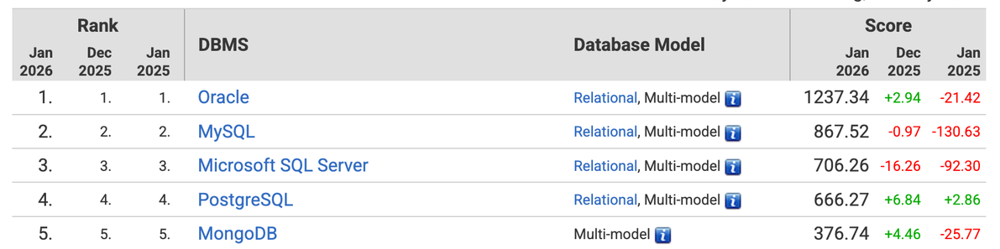
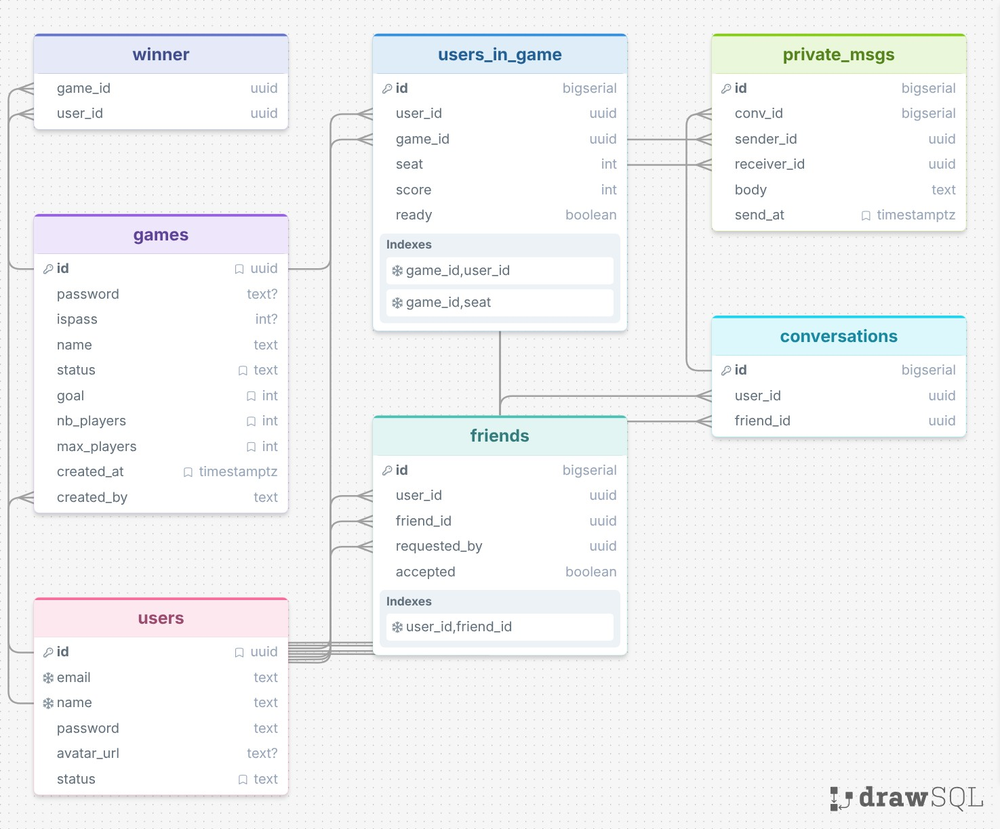

*This project has been created as part of the 42 curriculum by ibaaziz, homohame, mkerrien, benjamsc*
# Description
The goal of our project was to create an online version of the game Skyjo [rules](./docs/rules/RULES.en.md)
    that can accommodate 2 to 4 players in real time, with basic user interactions.
Dashboards are built with grafana and exporters like prometheus and postgres-exporter.

### Team information
The work was divided into four parts: 
- Benjamsc, developer, handled the DevOps/infrastructure side, everything related to containerization and configuring the various services.
- Ibaaziz, product owner, handled the backend, using Express.js to create all the routes and the underlying logic. Updated the API docs with Apidog to allow everyone to check the routes.
- Mkerrien, product manager, built a state machine for the `game engine` in `TypeScript`, which was integrated into the backend.
- Homohame, product manager, handled the entire frontend part and the offline play using `React` .

### Project Management
To organize ourselves and prepare our work, we used tools like Discord (linking a channel via a webhook to GitHub), Google Sheets, and online tools such as Excalidraw and DrawSQL.
We met once a week, and when needed organized work hangouts, so that we could stay up to date with each other's work.

[Container Architectural diagram](./docs/ft_skyjo_architecutreContainers.svg)

[Backend Architectural diagram](./docs/Skyjo_architecture_EN_2026-10-25.pbg.svg)

 Technical stack

### Frontend:
- Framework React, Tailwind
- lib: dayJs, react-router, axios, socket.io-client

### Backend:
- Framework expressJs
- lib: Socket.io, JWT, pg-promise, bcrypt, Postman

### Database
- Postgres
- Why postgres: open-source, lot of docs and tools made by community, and a significant market share.

[source](https://welovedevs.com/articles/les-chiffres-qui-montrent-ladoption-de-postgresql/)

 Sql scheme

 Features

- Online gameplay (2 or more real-time multiplayer, calls to internal game engine functions, communication via socket.io)
- Offline gameplay (entire game simulated offline, statistics not saved)
- Global chat with content moderation
- Friends system (add and remove friends, list...)
- Profiles (editing, avatar, online status, profile page with game stats)
- Public Api ([documentation here](https://1tsay81bor.apidog.io/))
- Logs Visualizer (loki, Grafana)
- Dashboards with data visualization (Grafana)

 Modules table

| Module | Type | Pts | Justification | WHO |
|---------------------------------------|:------:|:---:|------------------------------------|:---------------:|
| Use frontend framework| minor| 1 | React was chosen, it's a modern framework widely used and a SPA which allow for fast browsing | Houssen |
| Use backend framework| minor| 1 | Express was chosen, modern framework, with a lot of documentations and many compatible libraries | Ibtihal |
| Support for additional browsers| minor| 1 | We mostly use different browsers so this one was a given | Everyone |
| Game statistics and match history| minor| 1 | We made a game and statistics are fun | Houssen, Ibtihal, Matisse |
| Content moderation AI (auto mods, auto deletion) | minor| 1 | Easy module | Ibtihal |
| Public Api| major| 2 | Wanted to use Postman | Ibtihal |
| Andvanced analytics dashboard with data visualization| major| 2 | Cool to see Data and numbers | Benjamin |
| Monitoring system with Prometheus and Grafana| major| 2 | Practical and fun with a good doc | Benjamin |
| Implemented a complete web-based game where user can play each other| major| 2 | Started from here | Matisse |
| Remote Players | major | 2 | Easy module | Matisse, Benjamin |
| Multiplayer Game (more than 2)| major| 2 | Skyjo is multiplayer | Matisse, Houssen |
| Introduce an Ai Opponent for games| major| 2 | Easy | Houssen |
| Standard user management and authentication| major| 2 | Basic | Ibtihal, Houssen |
| Implement real-time features using Websocket| major| 2 | To allow real time gaming, and smooth browsing | Ibtihal, Houssen, Matisse |
| Allow users to interact with other users (basic chat, friends)| major| 2 | Fun to do | Houssen, Ibtihal |
|TOTAL| | 25 | | |

# Instructions

 Prerequisites

- Git, GNU Make, Bash, Docker + Docker Compose (or Podman + a Compose provider), curl, 7z, and standard Unix utilities (sed, awk, grep, file, coreutils).
- Configuration: 
    - the required environment variables in `./srcs/.env` (from `./srcs/.env.example`): `APP_PORT`, `POSTGRES_USER`, `POSTGRES_DB`, `GF_SMTP_USER`, `CONTAINER`, `SOCKET`, `RENDER_TOKEN`, `BACKEND_PORT`
    - the required secret files (`API_KEY.txt`, `GF_SMTP_PASSWORD.txt`, `GRAFANA_ADMIN_PASSWORD.txt`, `JWT_SECRETKEY.txt`, `POSTGRES_PASSWORD.txt`, `SMTP_ADDRESS.txt`).
- `Node.js`, `npm`, `PostgreSQL` and other application dependencies are installed automatically inside the containers.

 Users

To use the project as a product:
A simple `make` command is all that’s needed to initialize it, then use `make down` to stop the services and `make up` to restart them (without losing data).

To recompile everything without losing the volumes, use `make rl` or `make clean && make`.

`make clean-volumes` deletes the volumes as well as the local images.

The `make fclean` command deletes everything: the volumes, the local images, the downloaded images, and even the Docker/Podman cache.

There are a few additional `make` utility commands listed in `make help`.

 Dev

The basic `make` commands all have a dev version (listed in `make help`) (ex: `make dev`, `make dev-rl`,...)

The changes are:
- The module nodes in the frontend and backend are mounted as volumes to avoid having to rebuild everything every time
- The frontend and backend sources are also mounted as volumes to allow for more responsive changes
- All services are exposed locally to facilitate testing
- Logs can be viewed directly at htts://localhost:yourAppPort/logs

For information on the game engine, see [GE Dev Docs](./docs/DEV_DOC_GAME.en.md);

## Ressources

 links

### Containerization
- [Healthcheck](https://docs.docker.com/reference/compose-file/services/#healthcheck)
- [compose build](https://docs.docker.com/reference/compose-file/build/)
- [dependecies](https://docs.docker.com/compose/gettingstarted/)
- [podman](https://docs.podman.io/en/latest/)

### Postgres
- [doc](https://docs.postgresql.fr/18/intro-whatis.html)
- [docker hub ](https://hub.docker.com/_/postgres/)
- [docker env var](https://github.com/docker-library/docs/blob/master/postgres/README.md#environment-variables)
- [sql cheatsheet](https://www.geeksforgeeks.org/sql/sql-cheat-sheet/)
- [sql course](https://www.w3schools.com/sql/)

### Grafana
- [main Doc](https://grafana.com/docs/grafana/latest/)
- [alerting](https://grafana.com/docs/grafana-cloud/observe-and-act/alert-and-measure-reliability/alerting/)
#### Loki
- [deployement modes](https://grafana.com/docs/loki/latest/get-started/deployment-modes/)
#### Alloy
- [alloy](https://grafana.com/docs/alloy/latest/)

### Node
- [Best practices docker node](https://github.com/nodejs/docker-node/blob/main/docs/BestPractices.md)
- [docker hub Node](https://hub.docker.com/_/node/)
- [socket io](https://socket.io/docs/v4)
- [expresJs](https://expressjs.com/)
- [TypeScript documentation](https://www.typescriptlang.org/docs/)
- [pg_promise](https://vitaly-t.github.io/pg-promise/)
#### React
- [ecole-du-web](https://github.com/ecole-du-web/react-modal/tree/main)
- [Popup Modal](https://www.youtube.com/watch?v=Gy4G68WoHq4)
- [Websockets (socket.io)](https://www.youtube.com/watch?v=JyW9NDdXAtM)
- [JS Form Validation](https://www.youtube.com/watch?v=brcHK3P6ChQ&list=PL0Zuz27SZ-6PRCpm9clX0WiBEMB70FWwd&index=4)
- [Router](https://reactrouter.com/start/framework/navigating)
- [Full course](https://www.youtube.com/watch?v=TtPXvEcE11E)

### AI usage
- Assistance in creating scripts that run curl requests to create users and retrieve their “access_token” and UUID, so that tests and verifications can then be performed manually
- Assistance in setting up connections between the game engine and the rest of the backend
- Assistance with translating certain commit/PR messages
- Assistance in diagram creation/doc redaction or translation
- Help to navigate in the documentations.

