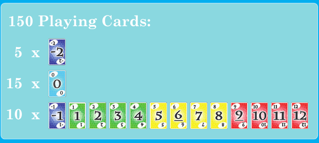
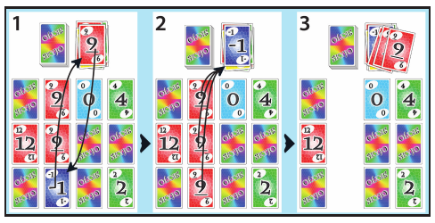
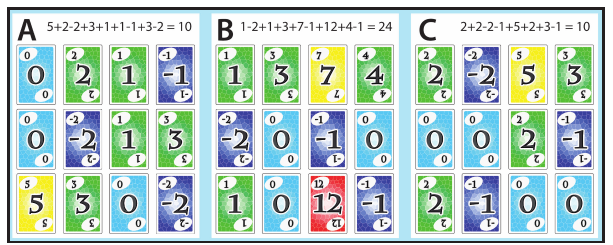

# SKYJO - Game Rules

> Rules used by this digital version of SKYJO.

## Quick Overview

- **Players:** 2 to 4.
- **Objective:** finish the game with the **lowest cumulative score**.
- At the start of each round, each player receives **12 face-down cards arranged in 3 rows x 4 columns**. During the first round, each player reveals **2 cards of their choice**.
- On their turn, a player may either:
  1. take the visible card from the top of the discard pile and **swap it** with one of their cards;
  2. draw the top face-down card from the draw pile, then either **swap it** with one of their cards or **discard it and reveal one of their face-down cards**.
- Three identical face-up cards in the **same vertical column** are immediately removed and placed on the discard pile.
- A round enters its final phase when a player has no face-down cards left. All other players then get **one final turn**.
- At the end of the round, any remaining columns of identical cards are removed before scores are calculated.
- The player who triggered the end of the round must have a round score **strictly lower** than every other player's. If another player has an equal or lower score, the finisher's **positive** score is doubled. A score of zero or less is never doubled.
- Round scores are added to cumulative scores. After a round in which at least one player reaches **100 points (by default) or more**, the game ends; the lowest cumulative score wins.

---

## 1. Deck Composition

The game contains **150 cards**.

| Value | Number of cards |
| ---: | ---: |
| `-2` | 5 |
| `-1` | 10 |
| `0` | 15 |
| `1` to `12` | 10 copies of each value |



*Card distribution.*

The value printed on a card directly corresponds to the number of points it contributes. Lower values are therefore generally preferable.

## 2. Objective of the Game

SKYJO is played over several rounds. Players accumulate points from one round to the next.

The objective is to keep the cumulative score as low as possible. After scoring a round, if at least one player has a cumulative score of **100 points (by default) or more**, the game ends. The player or players with the lowest cumulative score at that point win the game.

## 3. Terminology

- **Board:** all cards belonging to a player during a round.
- **Face-down card:** a card on a player's board whose value is not visible.
- **Face-up card:** a revealed card whose value is visible to everyone.
- **Draw pile:** the face-down pile from which cards are drawn.
- **Discard pile:** the face-up pile; only its top card may be taken at the beginning of a turn.
- **Finisher:** the player whose board has no face-down cards left, thereby triggering the final-turn phase.
- **Round score:** points earned in a round after column removal and any finisher penalty.
- **Cumulative score:** the sum of a player's round scores since the start of the game.

## 4. Starting a Round

At the beginning of each round, the complete deck is shuffled.

Each player receives **12 face-down cards**, arranged in a fixed board of **3 rows x 4 columns**:

```text
[ ? ] [ ? ] [ ? ] [ ? ]
[ ? ] [ ? ] [ ? ] [ ? ]
[ ? ] [ ? ] [ ? ] [ ? ]
  C1    C2    C3    C4
```

Each vertical column therefore contains exactly three positions.

One additional card is placed face up to start the **discard pile**. All remaining cards form the face-down **draw pile**.

During the first round, each player chooses two cards on their board and reveals them. In subsequent rounds, all cards are initially face down, and the finisher of the previous round starts playing immediately.

## 5. Determining the Starting Player

### First Round

Once all players have revealed their two initial cards, the sum of those two cards is calculated for each player. The player with the **highest sum** starts the first round.

Example: a player who reveals `12` and `-2` has a sum of `10`, while a player who reveals `4` and `2` has a sum of `6`. The first player therefore starts the round.

If several players are tied for the highest initial sum, **one of those players is chosen at random** to start the first round.

### Subsequent Rounds

The **finisher of the previous round** starts the next round.

## 6. Turn Sequence

Players take turns in a fixed, circular order established for the game.

At the beginning of their turn, the active player chooses one of the following two options:

- take the face-up card at the top of the discard pile;
- draw the top card from the draw pile.

The available actions then depend on the chosen source.

## 7. Taking the Top Card from the Discard Pile

When a player takes the visible card from the top of the discard pile, that card **must be kept**: it cannot be immediately discarded again.

The player chooses a card on their own board to replace. That card may be face up or face down. If it is face down, its value cannot be inspected before the player has chosen its position.

The swap is then performed:

- the card taken from the discard pile is placed face up in the chosen position;
- the replaced card is placed face up on top of the discard pile;
- if the swap completes a vertical column of three identical face-up cards, that column is immediately removed according to the rule described in section 9.

The turn then ends.

## 8. Drawing a Card from the Draw Pile

When a player draws the top card from the draw pile, its value immediately becomes **visible to all players**. The player then chooses whether to keep or reject it.

### 8.1 Keeping the Drawn Card

The player chooses a card on their board to replace. That card may be face up or face down. A face-down card cannot be inspected before its position has been chosen.

The swap is then performed:

- the drawn card is placed face up in the chosen position;
- the replaced card is placed face up on top of the discard pile;
- if the swap completes a vertical column of three identical face-up cards, that column is immediately removed.

The turn then ends.

### 8.2 Rejecting the Drawn Card

If the player does not wish to keep the drawn card, it is placed face up on top of the discard pile.

The player must then choose **one of their own cards that is still face down** and reveal it. That card remains in its position.

If this reveal completes a vertical column of three identical face-up cards, that column is immediately removed.

The turn then ends.

It is not possible to reject the drawn card without revealing one of the player's own cards that is still face down.

## 9. Three Identical Cards in a Vertical Column

As soon as all three positions in a column contain **three face-up cards of the same value**, the entire column is removed from the board and all three cards are placed on the discard pile.



*A swap completes a column of three identical cards, which is then removed.*

Consequences:

- the three removed cards are no longer part of the player's board and therefore contribute **0 points** for that round;
- the three positions remain empty and are not filled again;
- the rule applies whether the third identical card appeared after a swap or after revealing a face-down card;
- if the column is completed by a swap, the **replaced card is first placed on the discard pile**, then the three identical cards are placed on top of it; one of the identical cards therefore becomes the new top card of the discard pile;
- the same rule applies during end-of-round resolution, when any remaining face-down cards are revealed.

## 10. Triggering the End of a Round

A player becomes the **finisher** when, after their action and any column removals have been fully resolved, their board contains **no face-down cards**.

The round does not end immediately. All other players still active get exactly **one final turn**, following the usual player order. The finisher does not play again during this phase.

Once every other player has completed this final turn, the round is over.

## 11. End-of-Round Resolution

After the final turns:

1. all cards still face down on the players' boards are automatically revealed;
2. all vertical columns consisting of three identical face-up cards are removed;
3. each player's round score is calculated from the cards remaining on their board.

Removed cards are not included in the score.

## 12. Round Scoring and Finisher Penalty

A player's round score is the sum of the values of all cards still present on their board after the final column removals.

The **finisher** is subject to an additional rule: their score must be **strictly lower** than every other player's score for that round.

If at least one other player has a score **lower than or equal to** the finisher's:

- if the finisher's score is **positive**, it is doubled;
- if the finisher's score is `0` or negative, it is **not** doubled.

No other player is subject to this penalty.



*Example: A finishes with 10 points, B has 24, and C also has 10. Because A is tied rather than strictly lower, A's positive score is doubled to 20.*

### Examples

| Finisher | Lowest other score | Penalty? | Recorded finisher score |
| ---: | ---: | :---: | ---: |
| `10` | `12` | No | `10` |
| `10` | `10` | Yes | `20` |
| `10` | `5` | Yes | `20` |
| `-2` | `-5` | No doubling | `-2` |

Once scoring is complete, each player's round score is automatically added to their cumulative score.

## 13. End of the Game and Next Round

The game ends when at least one player reaches or exceeds, after scoring a round, the point threshold defined when the game was created (100 points by default).

At the end of the game, the player or players with the **lowest cumulative score** win. If several players are tied for this lowest score, they are **co-winners**: no additional tie-breaker is used.

## 14. Additional Rules for This Digital Version

### 14.1 Empty Draw Pile

If the draw pile is empty when a card needs to be drawn, it is automatically replenished:

1. the visible card at the top of the discard pile remains in place;
2. all other cards from the discard pile are collected and shuffled;
3. those cards become the new face-down draw pile.

The top card of the discard pile is never included in this reshuffle.

### 14.2 Turn Time Limit

Each player has a limited amount of time to perform a valid action during their turn.

If the player whose turn it is does not perform any valid action before this time limit expires, **the game is stopped**.
